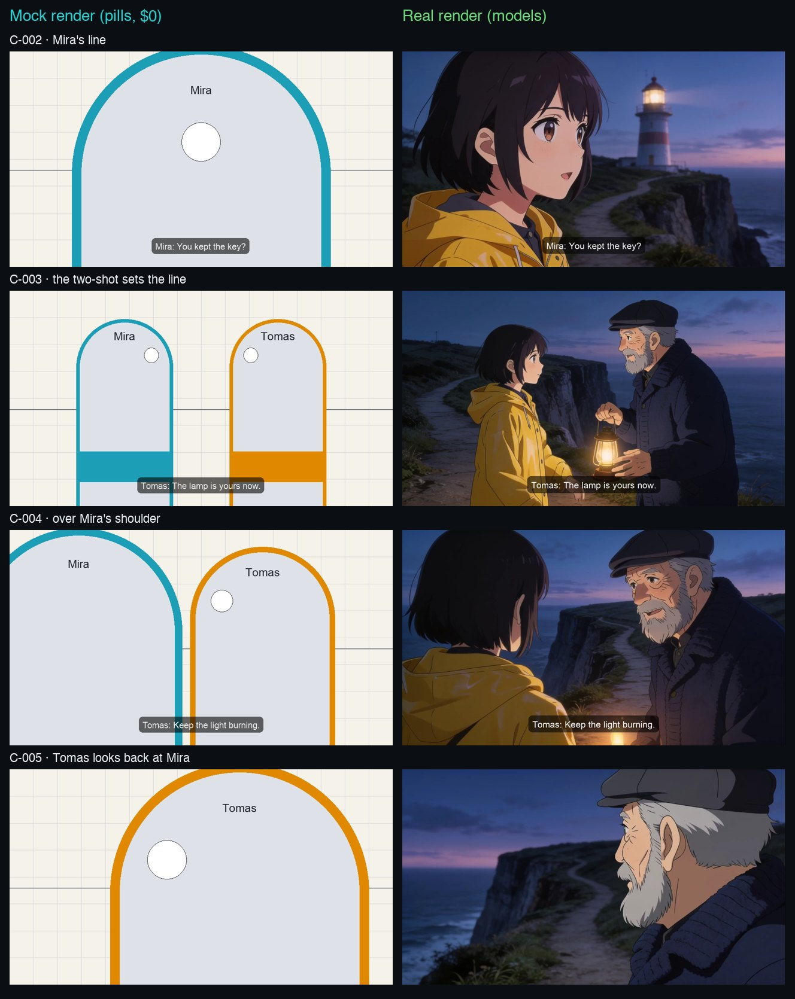

AI video goes wrong between the shots, not inside them. One clip is square and the next is wide, a character looks left and then right, one cut has sound and the next has none. This guide makes a short anime episode where every cut matches, because you check the whole episode for free before you pay for a single picture.

<Columns cols={2}>
  <Card title="What you get" icon="flag-checkered">
    A 20-second, 7-cut episode at 1920×1080, with the lines as subtitles and no sound.
  </Card>
  <Card title="Time to read" icon="clock">
    About 8 minutes. The steps take about an hour, most of it in planning.
  </Card>
</Columns>

## The example

This is episode 1 of a small show, *Lamp Oil*: a young lighthouse keeper, Mira, meets the old keeper, Tomas, on the cliff path, and then lights the great lamp. Every cut follows the steps in this guide.

<Frame caption="Lamp Oil, episode 1: 7 cuts, 19.9 seconds. Keyframes on Seedream 4.5, videos on Hailuo 2.3 Fast Pro, one camera move made by the engine at $0. Model spend: $2.17 at the prices of November 2026.">
  <video controls playsInline className="w-full aspect-video rounded-xl" src="/videos/anime-episode-example.mp4" poster="/images/learn/anime-episode-poster.jpg"></video>
</Frame>

And this is the process in the studio, from a new show to the export. It runs in demo mode, so the pictures are placeholders and nothing costs money.

<Frame caption="The steps in the Vinci studio, in demo mode ($0). 1 minute 30 seconds, no sound.">
  <video controls playsInline className="w-full aspect-video rounded-xl" src="/videos/anime-episode-walkthrough.mp4" poster="/images/learn/anime-episode-walkthrough-poster.jpg"></video>
</Frame>

## What you need

- The free and open source Vinci studio (the install is in step 1)
- A short script: scene headings, action and dialogue, in Fountain or plain text
- One sheet image for each character: the whole character, front view at least
- For the real render only: a model provider key (this example uses Wavespeed) and live spend turned on

## Steps

<Steps>
  <Step title="Start the studio in demo mode">
```bash
git clone https://github.com/tryvinci/vinci && cd vinci
python3 -m venv .venv && . .venv/bin/activate && make install
./scripts/vinci init --demo
./scripts/vinci studio
```
    Open the studio at `http://127.0.0.1:4310/studio` and pick **Shows** on the left rail. Demo mode uses practice models: every render costs $0, so you can try each step before you spend.
  </Step>
  <Step title="Create the show and the first character">
    Click **New show**. Give it a title, keep the medium **2D anime**, and pick **16:9**. Then add the first character: a name, one sentence about the look, and the whole character sheet. The sheet is the reference for every picture of that character, so use the same sheet for the whole show.
  </Step>
  <Step title="Paste the script">
    Paste the script in the next step. Each action paragraph and each line of dialogue becomes a shot, with a framing and a length. In a 2D anime show, a line gets the camerawork **kuchipaku-hold** (a held pose, only the mouth moves) and only its speaker in the shot. Click **Create show**.
  </Step>
  <Step title="Give every character a sheet">
    A speaker who is new in the script has no sheet yet, and the show stays invalid until it has one. Open the character in the **Bible** and add the sheet image.
  </Step>
  <Step title="Choose the camerawork of each shot">
    Open a shot from the storyboard and pick a template in the **Camerawork** menu. It fills the camera, the length and the words that go to the model. For a dialogue scene:
    - **two-shot-axis** on the first shot with both characters. It fixes who stands left and who stands right for the rest of the scene (the 180° line).
    - **ots-a** and **ots-b** for over-the-shoulder shots. They keep each character on their side.
    - **reaction-cu** for a short reaction close-up with no line.
    - An engine move (for example **tu-to-eyes** or **tilt-up-hero**) makes the video from the keyframe with no video model, for $0.
  </Step>
  <Step title="Check the staging with pills">
    Until a shot has a keyframe, the storyboard and the shot page show **pills**: one flat stand-in per character, with a white dot where they look. A character keeps one color in every shot. A single that looks off screen sits beside the centre, behind its gaze.

    If a shot turns the characters around, the shot page says **Crosses the 180° line**. Fix it before you render. For a single, write the direction into the shot's `blocking` in the scene file, so the words go to the model too:
```yaml
- id: e01/s01/sh050
  duration: 2+00
  description: "Tomas, alone, looks out to sea."
  camera: { framing: close_up }
  characters: [char/tomas]
  blocking: { char/tomas: "at the right of the frame, looking toward frame left" }
```
  </Step>
  <Step title="Check the timing on the e-conte sheet">
    Click **E-conte sheet** in the storyboard header. You get a PDF with 5 cuts a page: the cut number, the picture with the camera move, the action, the dialogue and the time in seconds+frames (`2+12` is 2.5 seconds). With no sound, a subtitle must stay long enough to read: give each line about 2 seconds.
  </Step>
  <Step title="Watch the mock render">
    Click **Mock render**. You get one video of the whole episode, every cut drawn from its pills under its camera move, with no sound and each line as a subtitle. It costs $0. Watch it once: if the cuts do not flow as pills, they will not flow as paintings either. Fix the staging and the timing now.
  </Step>
  <Step title="Render with real models">
    Add your provider key under **Connect**, and start the studio with live spend on (`VINCI_ALLOW_LIVE_SPEND=1`). Every render shows its price first.

    Render the keyframe of one shot, approve it, then render its video. Check that shot before you render the rest: the frame shape, the faces, where each character looks. Then render the other shots one by one, keyframe first.
  </Step>
  <Step title="Check that the cuts match">
    Play the shots in order and look at three things: the same frame shape in every cut, the same screen direction in a scene, and the same light in a scene. Render again only the shot that breaks. If a take still fits after you change only text (a line, a length), click **Keep v1 anyway** (with that take's name) on its stale banner: with no sound, the picture does not need to change.
  </Step>
  <Step title="Cut and export with no sound">
    Open **Cut** and click **Use approved takes**. In the export panel, keep **Burn-in subtitles** on, turn **Sound** off and click **Export episode**. The file has no audio stream, and each subtitle names its speaker (`Mira: You kept the key?`).
  </Step>
</Steps>

## Mock render and real render, side by side

The mock render is the plan; the real render follows it. Each cut keeps its place, its length, its subtitle and its screen direction.



<Tip>
  **Plan with pills, pay once.** The mock render and the e-conte sheet cost nothing. A change to a cut after the real render costs a keyframe and a video for that cut.
</Tip>

<Warning>
  **A model does not obey every word.** The template words and the blocking steer the model, but they do not bind it. Render one shot, check it, then render the next. In the example, one reaction shot came back with the light on the wrong side, and a new render of that shot fixed it.
</Warning>

## Before you publish

- [ ] Every character has a sheet
- [ ] The first two-shot of each dialogue scene sets the 180° line, and no shot crosses it
- [ ] Each line has about 2 seconds on screen
- [ ] The mock render plays as one episode
- [ ] Every cut has the same frame shape, and each scene keeps its screen direction and its light
- [ ] The export has subtitles and no sound

## Two ways to go further

<Columns cols={2}>
  <Card title="Let Vinci make it" icon="wand-magic-sparkles" href="https://tryvinci.com/meet?utm_source=guide&utm_medium=docs&utm_campaign=anime-episode">
    Send us the script and the character sheets, and we return the episode in your style. Book a demo to get started.
  </Card>
  <Card title="Free and open source Vinci" icon="github" href="https://github.com/tryvinci/vinci">
    Run the Vinci studio on your own machine with your own model keys. It shows the price before every render.
  </Card>
</Columns>

### Run this workflow from the command line

A show is a folder of plain files (Open Lore Format). The studio keeps it in `~/.vinci/shows/<show>`, and each step above also runs from the command line:

<Tabs>
  <Tab title="Plan ($0)">
```bash
./scripts/vinci olf validate -C ~/.vinci/shows/lamp-oil
./scripts/vinci olf template anime/two-shot-axis --shot e01/s01/sh030 -C ~/.vinci/shows/lamp-oil
./scripts/vinci olf previs e01 --sheet -C ~/.vinci/shows/lamp-oil
./scripts/vinci olf previs e01 --mock -C ~/.vinci/shows/lamp-oil
```
    `validate` prints the 180° warnings. The sheet and the mock render go to `previs/e01/` in the show folder.
  </Tab>
  <Tab title="Render">
```bash
./scripts/vinci olf render e01/s01/sh030 --dry-run -C ~/.vinci/shows/lamp-oil
./scripts/vinci olf render e01/s01/sh030 --yes -C ~/.vinci/shows/lamp-oil
./scripts/vinci olf review e01/s01/sh030/v1 --status approved -C ~/.vinci/shows/lamp-oil
```
    `--dry-run` prints the plan and the price; nothing runs. `--yes` spends it.
  </Tab>
  <Tab title="Export">
```bash
./scripts/vinci olf cut e01 --use-approved -C ~/.vinci/shows/lamp-oil
./scripts/vinci olf export e01 --aspect 16:9 --no-sound -C ~/.vinci/shows/lamp-oil
```
    The episode goes to `exports/e01/` in the show folder, with the subtitles as an `.srt` file too.
  </Tab>
</Tabs>

## More guides

<Columns cols={2}>
  <Card title="Stop paying for AI clips you throw away" icon="receipt" href="/learn/ai-video-cost" />
  <Card title="Five things that break an AI product ad" icon="list-check" href="/learn/keep-the-label-intact" />
</Columns>
