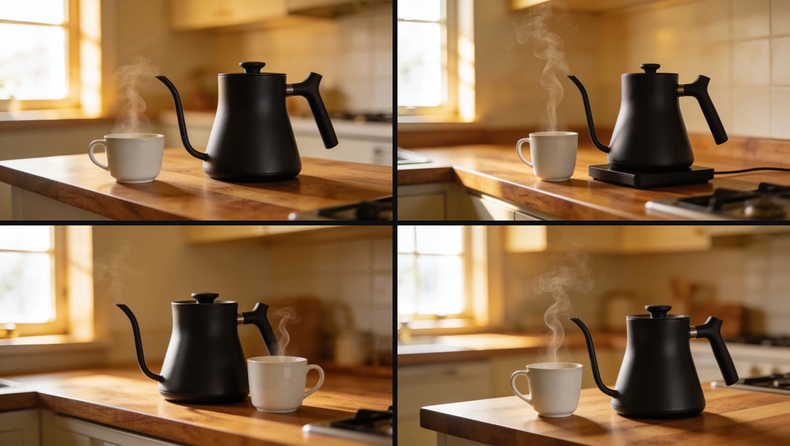

The first take of an AI still is rarely the best take. The light, the steam and the angle change from one generation to the next. This guide makes four takes from one prompt on the **Image** page of the studio, so that you choose the best take, not the first one.

<Columns cols={2}>
  <Card title="What you get" icon="flag-checkered">
    Four 2560×1440 stills of one product scene, from one prompt, for $0.16.
  </Card>
  <Card title="Time to read" icon="clock">
    About 4 minutes. The steps take about 5 minutes.
  </Card>
</Columns>

## The example

One prompt and four takes on Seedream 4.5. Each take has its own seed, so the kettle, the cup and the steam are a little different in each picture.

<Frame caption="Four takes from one prompt on Seedream 4.5, 2560×1440 each. Model spend: $0.16 ($0.04 for each still) at the prices of November 2026.">
  
</Frame>

And this is the process in the studio, with Seedream 4.5. This run made four new takes from the same prompt.

<Frame caption="The steps on the Image page with Seedream 4.5. Model spend: $0.16. The wait for the four takes (about 50 seconds) is cut. 36 seconds, no sound.">
  <video controls playsInline className="w-full aspect-video rounded-xl" src="/videos/four-stills-walkthrough.mp4" poster="/images/learn/four-stills-walkthrough-poster.jpg"></video>
</Frame>

## What you need

- The free and open source Vinci studio (the install is in step 1)
- A model provider key (this example uses Wavespeed). [Your own accounts](/learn/your-own-accounts) shows how to get one and connect it.
- One sentence about the product, the place and the light

## Steps

<Steps>
  <Step title="Start the studio with live spend on">
```bash
git clone https://github.com/tryvinci/vinci && cd vinci
python3 -m venv .venv && . .venv/bin/activate && make install
./scripts/vinci init
VINCI_ALLOW_LIVE_SPEND=1 ./scripts/vinci studio
```
    The studio opens at `http://127.0.0.1:4311`. Open **Connect** on the left rail and add your provider key. Then pick **Image** on the left rail. Live spend stays off until you start the studio with `VINCI_ALLOW_LIVE_SPEND=1`. If the studio already runs, stop it first with `./scripts/vinci stop`.
  </Step>
  <Step title="Write what you want to see">
    Write one prompt: the product, the place, the light and the lens. Use the same words for the product in every prompt. The example prompt:
```text
A matte black pour-over coffee kettle on a walnut kitchen counter, a white ceramic cup beside it with a thin curl of steam, soft morning light from a window on the left, shallow depth of field, product photography, 50mm lens.
```
  </Step>
  <Step title="Pick a model">
    Click the model chip next to the prompt. The list shows the models of the providers that you connected: the featured models at the top, and all models below them. The example uses **Seedream 4.5**.
  </Step>
  <Step title="Pick the shape">
    Click the aspect chip. Pick **16:9** for a web page or a video, **9:16** for a phone screen, or **1:1** for a feed.
  </Step>
  <Step title="Make four takes at once">
    Click the batch chip and pick **4**. Each take gets its own seed, so you get four different pictures, not one picture four times.
  </Step>
  <Step title="Check the price, then generate">
    The price is on the **Generate** button. Four takes on Seedream 4.5 show $0.160. Click **Generate** one time. The takes show at the top of the page.
  </Step>
  <Step title="Keep the best take">
    Hover a take to see its actions. You can mark it as a favorite, download it, or click **Animate** to make a clip from it. The next guide starts here: [Turn a still into a 6-second clip](/learn/animate-a-still).
  </Step>
</Steps>

<Tip>
  **The same prompt again costs $0.** With a batch of 1, the same model, prompt and settings give the saved picture again, and nothing is billed. To get new takes, make a batch of 4, or change the prompt.
</Tip>

<Warning>
  **A model does not obey every word.** In the example, the second take (top right) put the kettle on an electric base, and the prompt did not ask for one. Look at every take before you use it.
</Warning>

## Before you use a still

- [ ] The product has the same shape, color and label as the real product
- [ ] The shape fits where the still goes: 16:9, 9:16 or 1:1
- [ ] There is nothing in the picture that the prompt did not ask for

## Two ways to go further

<Columns cols={2}>
  <Card title="Let Vinci make it" icon="wand-magic-sparkles" href="https://tryvinci.com/meet?utm_source=guide&utm_medium=docs&utm_campaign=four-stills">
    Send us your product photos, and we return a set of stills in your brand style. Book a demo to get started.
  </Card>
  <Card title="Free and open source Vinci" icon="github" href="https://github.com/tryvinci/vinci">
    Run the Vinci studio on your own machine with your own model keys. It shows the price before every run.
  </Card>
</Columns>

## More guides

<Columns cols={2}>
  <Card title="Turn a still into a 6-second clip" icon="video" href="/learn/animate-a-still" />
  <Card title="Chain a still and a clip on the canvas" icon="diagram-project" href="/learn/still-to-clip-on-the-canvas" />
</Columns>
