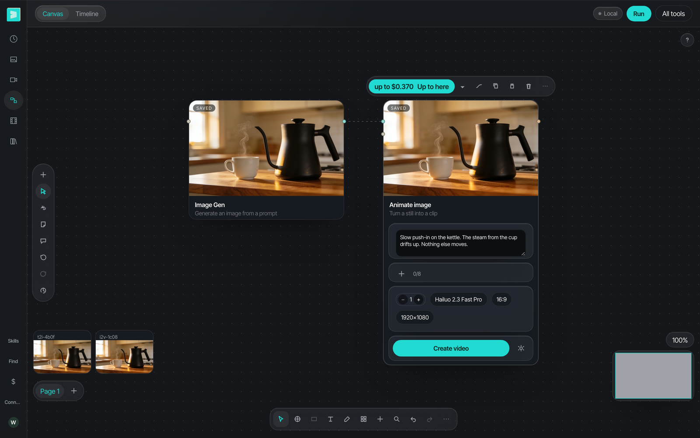

The **Image** and **Video** pages make one thing at a time. The **Canvas** keeps the steps together: a node that makes the still, a wire, and a node that animates the still. You run the chain with one click. When you change one node, only that node and the nodes after it cost money again.

<Columns cols={2}>
  <Card title="What you get" icon="flag-checkered">
    A still and a 6-second clip made from it, in one run, for $0.37.
  </Card>
  <Card title="Time to read" icon="clock">
    About 5 minutes. The steps take about 5 minutes, and the run takes about 2 minutes.
  </Card>
</Columns>

## The example

**Image Gen** on Seedream 4.5 makes the still, and **Animate image** on Hailuo 2.3 Fast Pro makes the clip from it. One click on **Up to here** ran both nodes.

<Frame caption="The clip at the end of the chain (6-second setting): 5.9 seconds, no sound. Model spend for the run: $0.37 ($0.04 for the still and $0.33 for the clip) at the prices of November 2026.">
  <video controls playsInline loop className="w-full aspect-video rounded-xl" src="/videos/still-to-clip-example.mp4" poster="/images/learn/still-to-clip-example-poster.jpg"></video>
</Frame>

<Frame caption="The chain after a second run of the same nodes: both results came back saved, for $0. The bar above the selected node shows the price of the run: up to $0.370.">
  
</Frame>

And this is the process in the studio, with the same nodes, prompts and models as the example. Nothing changed, so both nodes gave back their saved results for $0, and each result shows a **Saved** tag (step 7 explains this).

<Frame caption="The steps on the canvas with Seedream 4.5 and Hailuo 2.3 Fast Pro. The still and the clip came back from the saved results, so this run cost $0. 49 seconds, no sound.">
  <video controls playsInline className="w-full aspect-video rounded-xl" src="/videos/still-to-clip-walkthrough.mp4" poster="/images/learn/still-to-clip-walkthrough-poster.jpg"></video>
</Frame>

## What you need

- The free and open source Vinci studio, with live spend on (the install is in step 1 of the [Image guide](/learn/four-stills-from-one-prompt))
- A model provider key (this example uses Wavespeed)
- A prompt for the still and a prompt for the move. The [Image](/learn/four-stills-from-one-prompt) and [Video](/learn/animate-a-still) guides show how to write them.

## Steps

<Steps>
  <Step title="Open the canvas and add the first node">
    Pick **Canvas** on the left rail. On an empty canvas, click **Image Gen**. If the bottom of the node is below the toolbar, scroll the canvas up.
  </Step>
  <Step title="Write the still">
    Type the prompt of the still in the node.
  </Step>
  <Step title="Pick the model and the shape on the node">
    The pills under the prompt show the model, the shape and the size. Click a pill to change it. A run sends the values on the pills. The example uses **Seedream 4.5** at **16:9**.
  </Step>
  <Step title="Add the clip node">
    Click the out port on the right edge of the node, and pick **Animate image**. The studio adds the new node and connects it: the still goes into the new node as its start frame.
  </Step>
  <Step title="Describe the move">
    Type the move in the new node, as on the Video page: `Slow push-in on the kettle. The steam from the cup drifts up. Nothing else moves.` Pick its model on its pill. The example uses **Hailuo 2.3 Fast Pro**.
  </Step>
  <Step title="Select the last node, then run up to here">
    Click the clip node. The bar above it shows the price and **Up to here**: up to $0.370 in the example. Click it one time. The still runs first, then the clip. Each node shows its result when it is done.
  </Step>
  <Step title="Change one node and run again">
    To try a different move, change the prompt of the clip node and click **Up to here** again. The still node did not change, so its saved result comes back for $0, and you pay only for the new clip.
  </Step>
</Steps>

<Tip>
  **Check the still before you pay for the clip.** Select the still node and click **Up to here**: only the still runs ($0.04 in the example). When the still is right, select the clip node and run again. The still comes back for $0.
</Tip>

<Note>
  The price on the bar is the most that the run can cost. It adds the price of each node in the run, and a node with a saved result costs $0. The menu next to **Up to here** also has **This node only** and **Whole page**.
</Note>

## Before you run the chain

- [ ] The still is right before you run the clip node
- [ ] The clip node has the shape of the still
- [ ] The price on the bar is the price that you expect

## Two ways to go further

<Columns cols={2}>
  <Card title="Let Vinci make it" icon="wand-magic-sparkles" href="https://tryvinci.com/meet?utm_source=guide&utm_medium=docs&utm_campaign=still-to-clip">
    Send us your product and your idea, and we return the stills and clips in your brand style. Book a demo to get started.
  </Card>
  <Card title="Free and open source Vinci" icon="github" href="https://github.com/tryvinci/vinci">
    Run the Vinci studio on your own machine with your own model keys. It shows the price before every run.
  </Card>
</Columns>

## More guides

<Columns cols={2}>
  <Card title="Make four product stills from one prompt" icon="image" href="/learn/four-stills-from-one-prompt" />
  <Card title="Turn a still into a 6-second clip" icon="video" href="/learn/animate-a-still" />
</Columns>
