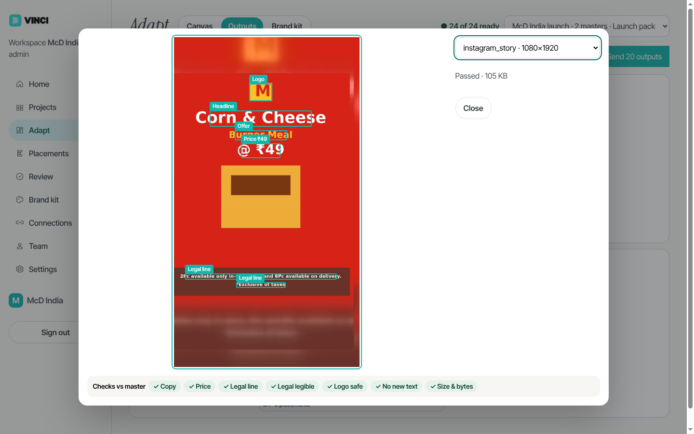

Every file Adapt makes is compared with your master before it can be exported. The master is the reference: if legal approved it, Adapt checks that each size still says exactly the same thing.

## The checks

| Check | A file fails when |
| --- | --- |
| Copy exact | A headline or offer line differs from the master. Case and punctuation are ignored. |
| Price exact | The price is missing or changed, for example ₹49 becomes ₹99. |
| Legal present | A legal line from the master or from your brand kit for that market is missing. |
| Legal legible | Legal text is smaller than 7 px cap height at the output size. |
| Logo safe | The logo sits inside the placement's safe area, such as under the Story profile bar. |
| No new text | The file contains words that are not in the master. Text printed on the product itself is allowed on packshots and product shots. |
| Size and file limit | The file has the wrong pixel size, or is over the placement's file-size limit. |

Turning off a brand rule for a batch removes its check. For example, with **Lock price and offer** off, the price check does not run.

## When a file fails

1. Adapt re-lays out that shape once, naming exactly what was changed or dropped.
2. If it passes, the new files replace the failed ones.
3. If it fails again, its files are marked **Needs review**, a review task is created and the assigned reviewer is notified.

Files that need review never go into an export or a push until someone approves them.

## Reviewing

Open **Review** to see every held file with each check, its result and the reason. You can:

- **Approve** a file to include it in exports and pushes.
- **Leave it out** of this batch.
- **Re-run** the shape with a note for the layout, for example "move the logo further from the corner" (available on enterprise only).
- **Edit in place**, nudging the logo or text block on the file and re-running the checks (available on enterprise only).

## Approval workflows

For teams with a formal sign-off, Adapt can require approval of every file, not only the held ones, before export (available on enterprise only). You can set:

- Reviewers by brand, market or campaign.
- Two-step approval, for example brand then legal.
- An audit trail of who approved each file and when, exportable for compliance.

## Custom checks

You can add checks for your own rules (available on enterprise only), such as:

- A required allergen or veg mark on every food placement.
- Minimum logo size or a fixed logo corner.
- Brand colours within tolerance.
- A banned-words list per market.
