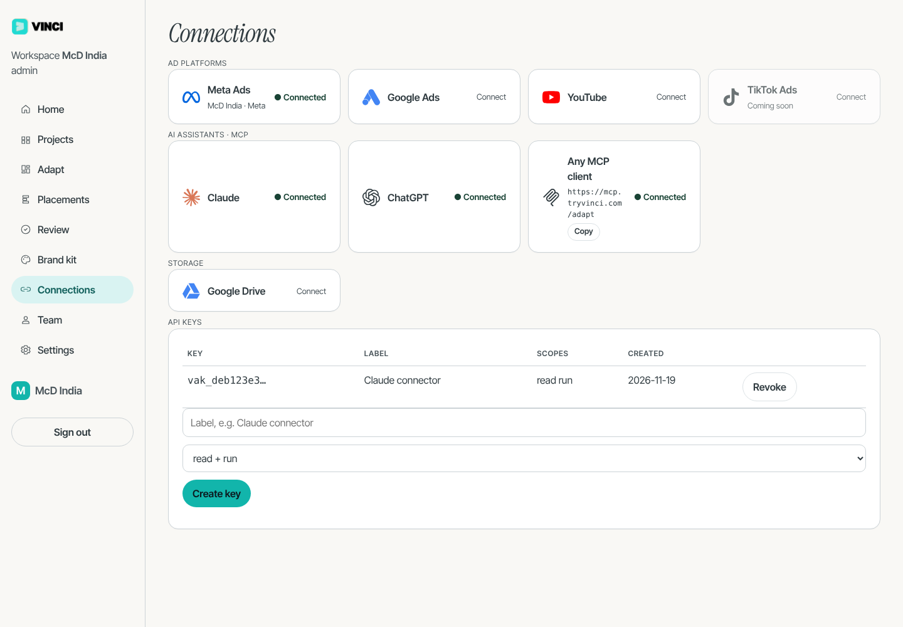

Connections send your approved files to the places they run, so nobody downloads a zip and re-uploads 40 files by hand. Only files that passed their checks, or that a reviewer approved, are sent.

## Platforms

| Platform | What Adapt sends |
| --- | --- |
| Meta Ads | 1:1 feed, 9:16 Stories and Reels, 4:5 feed images to your ad account's image library |
| Google Ads | 1:1, 9:16 and 16:9 images as image assets |
| YouTube | 9:16 Shorts covers and 16:9 in-stream companion images |
| Google Drive | Every placement, in a folder per batch with one subfolder per placement |
| Claude, ChatGPT, any MCP client | The full Adapt tool set. See [MCP](/products/adapt/mcp) |
| TikTok Ads | 9:16 and 1:1 images (available on enterprise only) |
| Amazon Ads, DV360, The Trade Desk | Display and video sizes (available on enterprise only) |
| Dropbox, Box, SharePoint | Every placement, folder per batch (available on enterprise only) |
| Your DAM (Bynder, Brandfolder, Adobe AEM) | Masters in, finished files out with their check results as metadata (available on enterprise only) |
| Swiggy, Zomato and retail-media portals | Banner sizes, through your account manager's upload format (available on enterprise only) |
| Slack, Microsoft Teams | Batch-ready and needs-review notices (available on enterprise only) |

## Connect a platform

<Steps>
  <Step title="Open Connections">
    Go to **Connections** in Adapt. Only workspace admins can add or remove connections.
  </Step>
  <Step title="Add the account">
    Choose the platform and sign in with an account that can upload to the ad account or folder you want.
  </Step>
  <Step title="Push a batch">
    On a finished batch, choose **Send** and pick the connection. Confirm the push.
  </Step>
</Steps>

## How pushes behave

- Every push asks you to confirm first.
- Pushes are safe to retry: sending the same batch twice does not upload duplicates.
- Access tokens are encrypted at rest and are never shown again after you connect.
- Removing a connection stops future pushes; files already sent stay in the platform.
