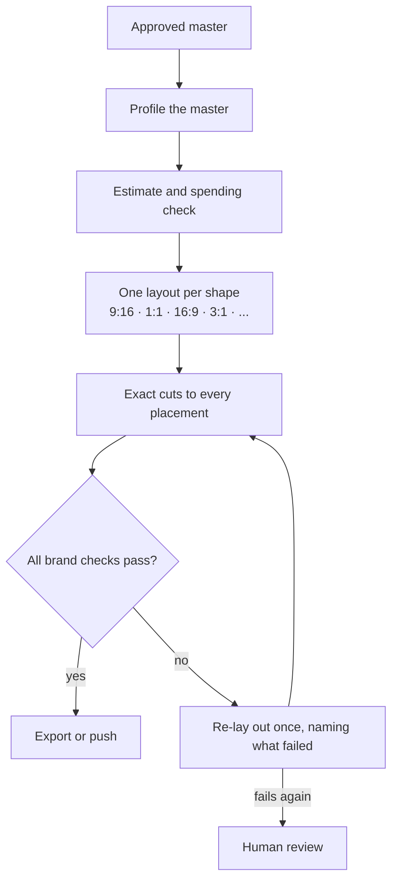

Adapt re-lays out your master once for each shape your placements need, then cuts every size from that layout and checks each file against the master. You pay for one layout per shape, not one per placement, so a 12-placement pack costs about as much as four.

## 1. Profile the master

Adapt reads your master and lists every text block (headline, offer, price, legal lines), the logo position and the kind of creative: campaign post, packshot or product shot. This profile is the reference that every output is checked against.

## 2. Estimate

Before anything runs, you see the cost and time for the batch. If the batch would take your workspace past its monthly spending limit, Adapt stops here and nothing is spent.

## 3. One layout per shape

Placements that share a shape share one layout. A launch pack of 12 placements uses four layouts: 9:16, 1:1, 16:9 and 3:1. For each one, Adapt re-composes the master for that shape. It keeps every word, the price and the legal lines exactly as they are, and only moves blocks, extends the background and rescales the product.

If your master is already the right shape, Adapt uses it as is and does not re-lay it out.

Each layout is stored as soon as it is made. If you run the same master again with the same rules, Adapt reuses the stored layouts and you only pay for the checks.

## 4. Exact cuts to every placement

Every placement is cut from its layout with ordinary image processing, not AI, so the cut can't change your copy:

- **Same shape:** a straight resize.
- **Close shape:** a crop that keeps the text, price, legal and logo areas whole.
- **Different shape:** the layout is placed whole on a blurred extension of its own background.

Each file is saved in the placement's format and kept under its file-size limit.

## 5. Brand checks

Each output file is read and compared with the master profile. See [Brand checks and review](/products/adapt/brand-checks-and-review) for every check.

## 6. Retry, review, export

If a layout fails a check, Adapt re-lays it out once, telling the model exactly what it changed or dropped. If it fails again, its files are held for review and a reviewer is notified. Files that pass, and files a reviewer approves, go into your export.

## Speed and scale

| Batch | Typical time |
| --- | --- |
| 1 master, Delivery apps pack (3 placements) | About 35 seconds |
| 4 masters, Launch pack (48 files) | About 3 minutes |

Adapt runs up to six layouts at once per workspace. Larger batches run in waves; the estimate shows the expected time before you start. Higher concurrency for large catalogues is available (available on enterprise only).

## Spending and estimates

- Every batch shows its estimate before it runs.
- Each workspace has a monthly spending limit that an admin can change.
- Re-runs of the same master reuse stored layouts, so they cost a fraction of the first run.
- Usage reports by campaign, team and month (available on enterprise only).
