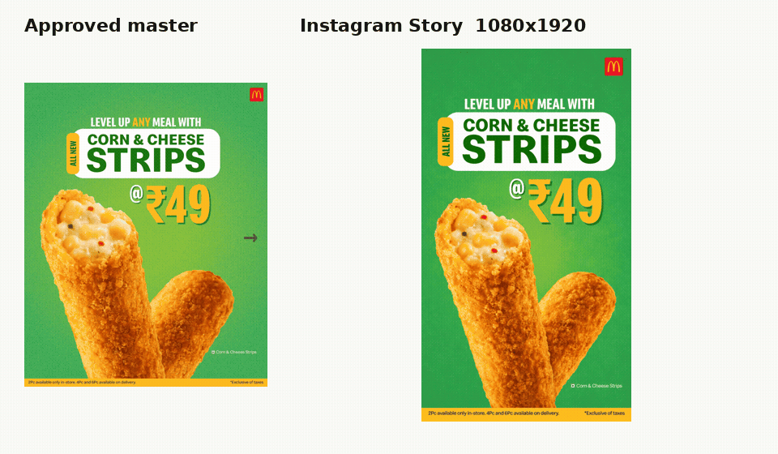

Adapt takes one approved master creative and returns every placement your campaign needs: Stories, feed posts, YouTube, digital menu boards, kiosks, delivery-app banners, display ads and print. Every file is checked against the master before you can export it, so the headline, the price and the legal line never drift.

<Note>
Adapt is available on Vinci Enterprise. Features marked (available on enterprise only) are switched on per workspace; talk to your account team to enable them.
</Note>

## What you get

<Columns cols={2}>
  <Card title="Every size from one master" icon="expand">
    Pick a pack of placements, or your own list. A 12-placement launch pack for one master is ready in two to three minutes.
  </Card>
  <Card title="Copy, price and legal locked" icon="lock">
    The headline, offer, price and legal lines are reproduced word for word. Only the background, layout and product scale change.
  </Card>
  <Card title="Checked before export" icon="badge-check">
    Each file is compared with the master. Files that fail go to a reviewer, never straight into your export.
  </Card>
  <Card title="Ship anywhere" icon="paper-plane">
    Download a ready-to-upload zip, push to ad platforms, or run Adapt from Claude, ChatGPT or your own code.
  </Card>
</Columns>

## Who it is for

- **Brand and marketing teams** that resize every launch into 10 to 50 sizes by hand.
- **Agencies** running many campaigns for many clients, with each client's brand rules and its own branded workspace.
- **Retail and QSR chains** with in-store screens, delivery apps, print and paid media all running the same offer.

## How a batch runs

1. Upload one or more approved masters.
2. Pick a pack, or a custom list of placements.
3. Check the estimate, then run.
4. Review anything that was held, then export or push.

Read [How Adapt works](/products/adapt/how-it-works) for what happens at each step.

## Where you can use it

| Surface | Use it for |
| --- | --- |
| [Web app](/products/adapt/quickstart) | Running batches, reviewing and exporting |
| [REST API](/products/adapt/api) | Running Adapt from your own tools and pipelines |
| [MCP](/products/adapt/mcp) | Running Adapt from Claude, ChatGPT or any MCP client |
| [Connections](/products/adapt/connections) | Pushing finished files to ad platforms and storage |

## Next steps

<Columns cols={2}>
  <Card title="Quickstart" icon="rocket" href="/products/adapt/quickstart">
    Run your first batch in the web app.
  </Card>
  <Card title="Placements and packs" icon="table-cells" href="/products/adapt/placements-and-packs">
    Every size Adapt makes, and how to add your own.
  </Card>
</Columns>
