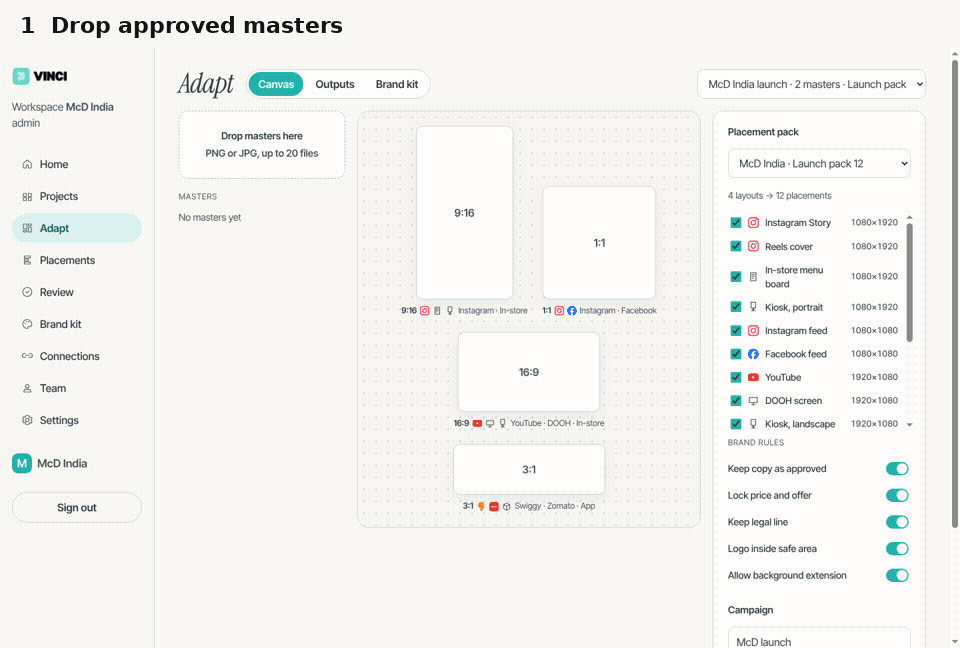
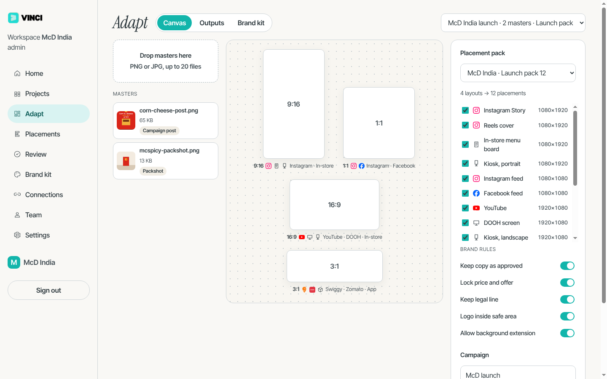
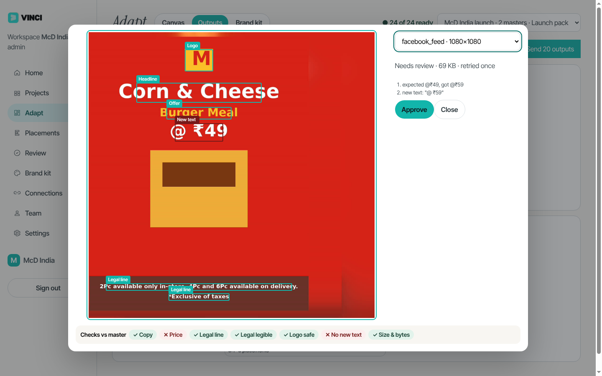
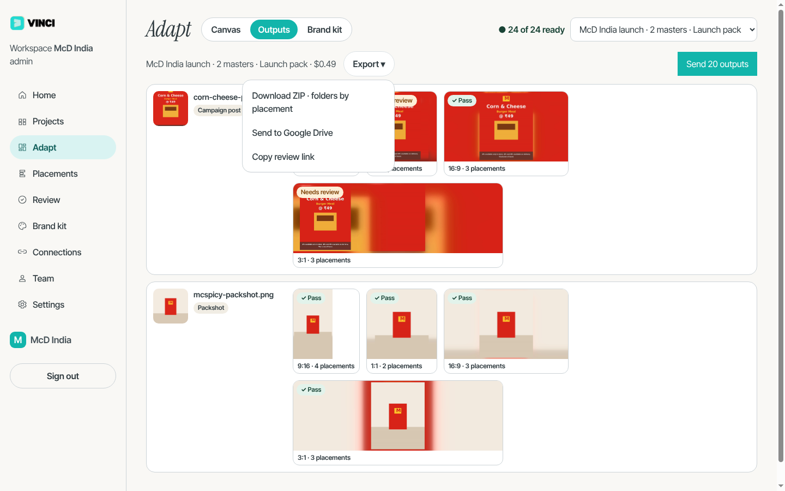

You can turn one approved master into a full set of placements in a few minutes from the web app.

## Prerequisites

- A Vinci workspace with Adapt enabled.
- One or more approved masters as PNG or JPG, up to 20 files per batch. Use the final file legal signed off, at the largest size you have.
- Your brand kit set up: legal lines per market and your logo. See [Workspace and brand](/products/adapt/workspace-and-brand).



## Run a batch

<Steps>
  <Step title="Upload your masters">
    Open **Adapt** and drop your masters on the canvas. Each one is profiled and labelled as a campaign post, packshot or product shot, with the text it found.
  </Step>
  <Step title="Pick a pack">
    Choose a pack, such as **Launch pack**, or tick the placements you want. The canvas shows one preview per shape and which placements come from it.
    
  </Step>
  <Step title="Check the brand rules">
    The rules are on by default: keep copy as approved, lock price and offer, keep the legal line, keep the logo inside the safe area, and allow background extension. Turn a rule off only when your brief allows it.
  </Step>
  <Step title="Run">
    Check the estimate, then select **Run**. Each master shows its progress as its layouts finish.
  </Step>
  <Step title="Review held files">
    Open **Outputs**. Files that passed every check are ready. Files marked **Needs review** show which check failed and why. Approve a file to include it in the export, or leave it out.
    
  </Step>
  <Step title="Export or push">
    Select **Export** to download a zip, or send the files to a connected platform. See [Connections](/products/adapt/connections).
    
  </Step>
</Steps>

## What the export contains

The zip has one folder per placement and one file per master, plus a manifest:

```text
instagram_story/
  corn-cheese-post.jpg
  mcspicy-packshot.jpg
swiggy_banner/
  corn-cheese-post.jpg
  mcspicy-packshot.jpg
...
manifest.json
```

`manifest.json` lists every file with its placement, size, file size and the result of each brand check, so your trafficking team or ad server can load it directly. Files waiting for review are left out until someone approves them.

## Tips

- Upload the highest-resolution master you have. Large and print sizes look best from a large source.
- Keep one offer per master. A master with two prices makes the price check ambiguous.
- Re-running a master with the same rules is cheap: Adapt reuses the stored layouts.
