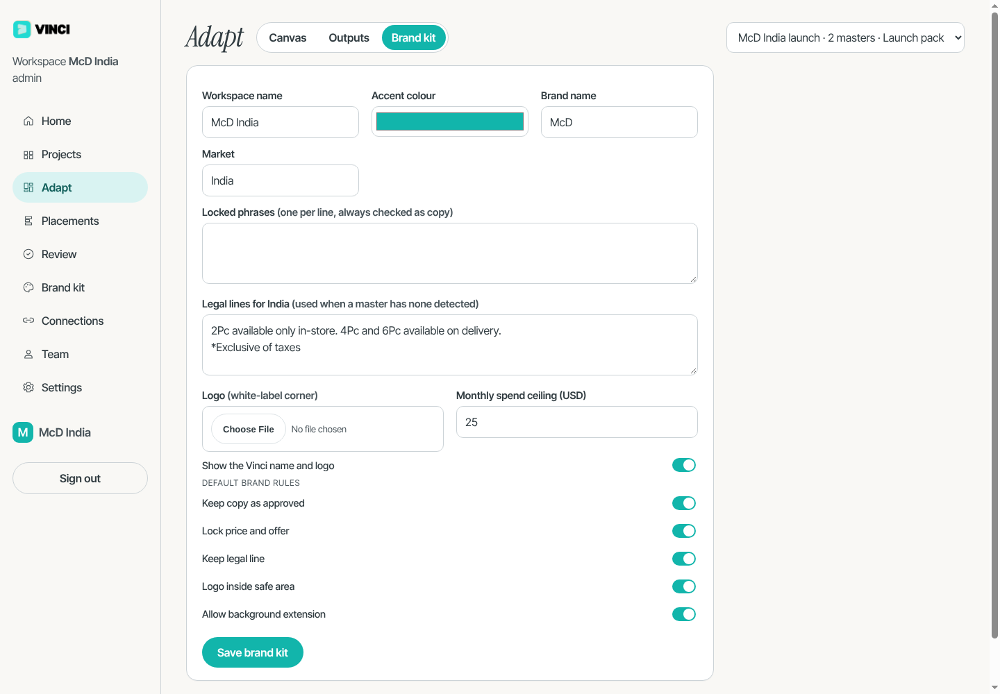
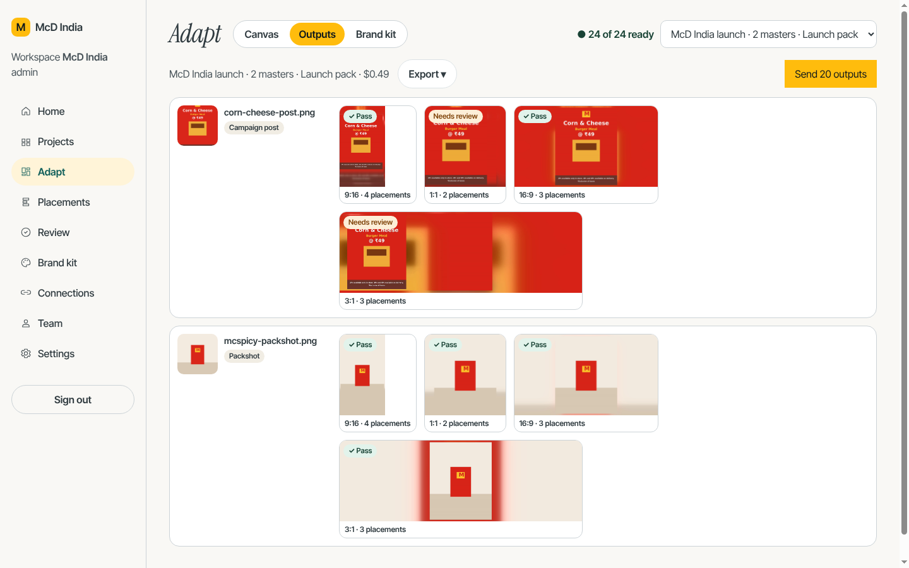

Each Adapt workspace holds one brand's kit, rules and team. Agencies run one workspace per client, each with its own branding.

## Brand kit

Open **Adapt → Brand kit** to set:

| Field | Used for |
| --- | --- |
| Brand and market | Labels in exports and the legal lines to apply |
| Legal lines per market | Added and checked on every file when the master has none, for example "*Exclusive of taxes" for India |
| Locked phrases | Words that must appear exactly, such as a product name or tagline |
| Logo files | Logo checks and white-label branding |

Also available on request (available on enterprise only):

- **Fonts and colours**, so rebuilt layouts and compact banners use your type and palette.
- **Required overlays**, such as a mandated footer for digital menu boards, added to every placement that needs it.
- **Markets and languages:** one master per market, each with its own legal lines, or translated copy checked against an approved translation list.

## Default brand rules

These apply to every batch unless a batch turns one off:

| Rule | On by default | What it does |
| --- | --- | --- |
| Keep copy as approved | Yes | Every word is kept; no new text is added |
| Lock price and offer | Yes | The price and offer are reproduced exactly |
| Keep legal line | Yes | Legal lines stay present and legible |
| Logo inside safe area | Yes | The logo stays clear of each placement's safe area |
| Allow background extension | Yes | The background may be extended to fill new shapes |

## Team and roles

| Role | Can |
| --- | --- |
| Admin | Everything, including brand kit, connections, API keys and the spending limit |
| Member | Upload masters, run batches, export and push |
| Reviewer | Review, approve or leave out held files |

Single sign-on (SAML or OIDC), SCIM user provisioning and custom roles are available (available on enterprise only).

## Spending limit

Each workspace has a monthly spending limit. Every batch shows its estimate first, and a batch that would go past the limit is refused before anything is spent. Admins change the limit with `PATCH /api/adapt/config` (`ceiling_usd`), or ask your account team.

## White-label

You can run Adapt under your own name, for example as "McD India Adapt" for a client:

- Display name, logo and accent colour on every page.
- With **Show Vinci** off, Vinci's name and links are removed from the app, emails, API responses and MCP tool descriptions.
- A workspace-specific MCP server URL.
- Your own domain, such as `adapt.yourbrand.com` (available on enterprise only).

## Security and data

- Masters and outputs are stored privately per workspace. Download links are signed and expire after 15 minutes.
- Connection tokens are encrypted at rest.
- Your masters are not used to train models.
- Data retention periods, regional data storage, audit logs and a security review pack are available (available on enterprise only).
